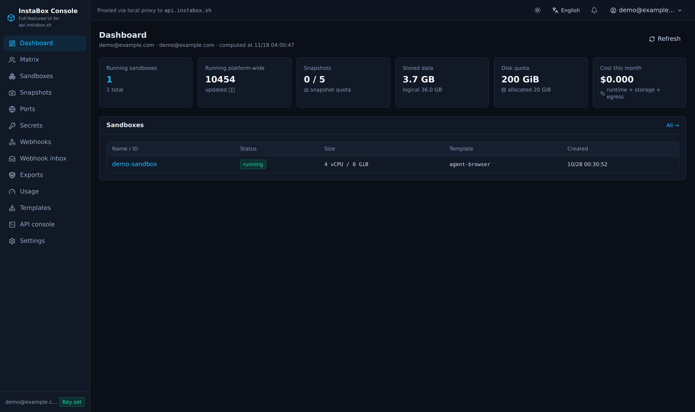
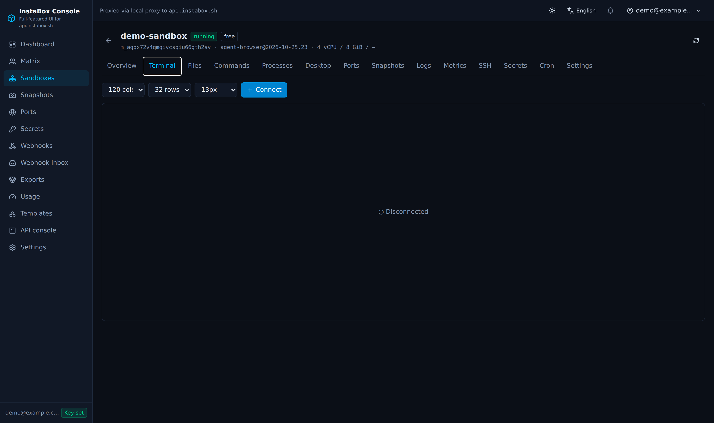
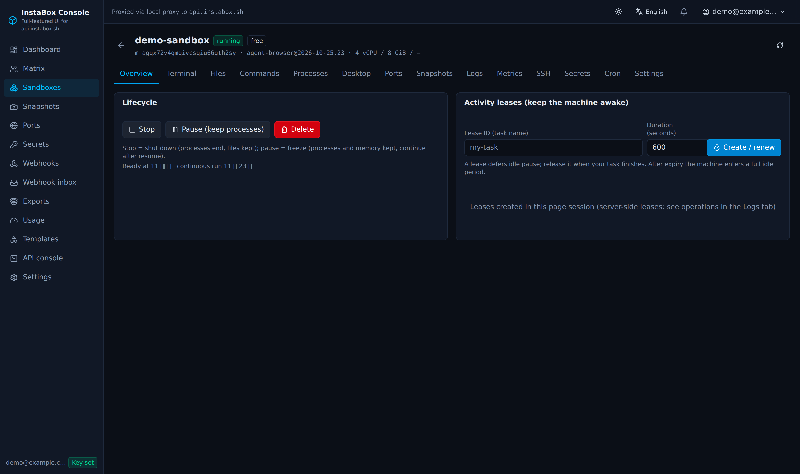
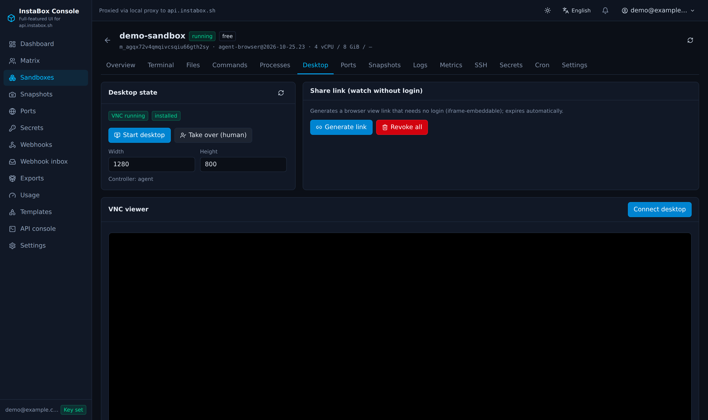

# InstaBox WebUI Console

**English** | [简体中文](README.zh-CN.md)

[](https://react.dev) [](https://vite.dev) [](LICENSE) [](https://nodejs.org)

A full-featured, dark-mode web console that brings **every API of [InstaBox](https://instabox.sh/docs)** (`api.instabox.sh`, 160 operations) into the browser — sandboxes, terminal, desktop, files, ports, SSH, snapshots, secrets, webhooks, monitoring and usage. Works with your API key only; no CLI, no SSH client required.

## Screenshots

| Dashboard | Web terminal |
| --- | --- |
|  |  |

| Sandbox detail (13 tabs) | VNC desktop |
| --- | --- |
|  |  |

More in [`docs/screenshots/`](docs/screenshots): matrix view, templates, ports, snapshots, secrets, webhooks, webhook inbox, exports, usage, API console, settings, file manager.

## Features

| Module | Capabilities |
|---|---|
| Dashboard | Account info, platform stats, storage / cost / quota cards, sandbox overview |
| Sandboxes | Create (template / size / env / metadata / auto-pause / scheduled delete), start / stop / suspend / resume / wake / delete, rename / resize / disk grow, restore to snapshot, fork clone, activity leases, **saved create profiles** (one-click presets) |
| Sandbox detail (13 tabs) | Overview · **Terminal** (xterm.js, **multi-tab sessions**, font size control) · **Files** (browse / edit with **Monaco editor** / upload / download, up to 5 GiB) · **Commands** (exec + history) · Processes (list / kill) · **Desktop** (install / start / takeover + noVNC + login-free share links) · **Ports** (publish HTTPS URLs, public/private, token rotation) · Snapshot / restore / fork · Serial console logs (incremental) · **Metrics** charts (CPU / memory / network / disk IO) · SSH (info / tokens / cert issuance) · machine-level Secrets · settings |
| Snapshots | List, delete, **browse snapshot files**, one-click create sandbox from snapshot |
| Ports | Global list of all published ports |
| Secrets | Org Secret CRUD, atomic batch import, proxy/env delivery, host scoping |
| Webhooks | Endpoint CRUD, enable / disable, test event, secret rotation, deliveries + retry (9 event types) |
| Exports | Pack a sandbox/snapshot `/data` as `.tar.gz`, poll status, download |
| Usage | Limits & cost breakdown, per-machine billing windows (incl. deleted), allowed sizes |
| Templates | All templates / versions / bundled software / default spec |
| **API console** | Browsable catalog of all 160 operations (generated from `openapi.yaml`) + generic request builder — covers every endpoint the UI doesn't have a page for |
| **Notifications & alerts** | Sandbox state changes and errors → browser push notifications + in-app event center; **alert rules** (monthly cost cap, continuous-run limit) with a 6-hour cooldown |
| **Webhook inbox** | Built-in receiver (`POST /hook`) — point InstaBox webhooks at the console and read the signed event stream right in the UI, no external service |
| **Feishu/Lark push** | Sandbox events (state changes incl. auto-pause, errors, cooldown entries, alert rules) pushed to a Feishu group custom bot — proxy-forwarded with domain allowlist and optional HMAC signature |
| **Cross-account board** | Every locally saved account pulled in parallel on one screen, with inline start/stop/pause/delete via per-account key override |
| Settings | Multi-account API key management (add / switch / remove), proxy health, deployment guide |

Extras: **bilingual UI** (English / 简体中文, follows your browser and switchable in one click) · **light/dark theme** · **PWA** (installable on your phone's home screen) · **command palette** (`Ctrl/⌘+K`: jump to pages, sandboxes, accounts) · **bulk actions** (select sandboxes → batch start/stop/pause/delete with progress) · **command snippets** (save and run common commands from any sandbox) · **activity log** of every write request · **config backup/restore** (export/import all local settings) · **mobile-friendly** (drawer sidebar, responsive tables) · async operations poll `GET /v1/operations/{id}?wait=25s` with live progress · API error envelopes translated into friendly messages.

## Why a proxy?

The InstaBox API does not allow cross-origin browser calls (CORS preflight returns 404), so this repo ships a zero-dependency (only `ws`) Node proxy:

```
Browser (React SPA)
   │  /p/*        REST passthrough (forwards Idempotency-Key / X-Confirm-Delete / Range, streaming, long-poll safe)
   │  /ws?url=…   WebSocket passthrough (terminal PTY / desktop VNC, target restricted to *.instabox.sh / *.instabox.tech)
   ▼
server/index.mjs  ──►  https://api.instabox.sh
   └─ Also serves dist/ statically (SPA fallback)
```

API keys live only in your **browser localStorage**; the proxy is stateless (optionally inject a server-side key via `INSTABOX_API_KEY`).

Two quirks of the InstaBox **port edge proxy** are handled transparently (these cost us a few debugging hours — read this before forking):

1. **Custom request headers are stripped** (`X-API-Key`, `Authorization` …). The browser therefore sends the key and Content-Type as **query parameters** (`?__key=…&__ct=…`); the proxy injects them as headers upstream and strips them from the upstream query. Proxy logs never contain credentials.
2. **Terminal/desktop tickets** (`POST /v1/machines/{id}/access`) return a `wss://connect.instabox.sh` URL bound to your browser Origin and requiring **two WebSocket subprotocols**: the response's `protocol` field (`instabox-access.v1`) plus `instabox-access-token.<token>`. The proxy forwards `Origin` and passes subprotocols via the WebSocket client's `protocols` argument (not custom headers — otherwise the server replies *"Server sent a subprotocol but none was requested"* and the connection drops). A `__subproto` query param acts as a fallback if the edge proxy ever starts stripping subprotocol headers.

## Getting started

```bash
npm install
npm run build     # tsc + vite → dist/
npm start         # proxy + static hosting on http://localhost:3000
```

Dev mode (optional):

```bash
node server/index.mjs   # terminal 1: proxy on 8787
npm run dev             # terminal 2: vite on 5173 (forwards /p, /ws)
```

Then click **Configure API Key** in the top bar:

1. Create a key at [dashboard.instabox.sh](https://dashboard.instabox.sh) → **API keys** (select **all scopes**: machines / images × read / write / delete), or run `instabox keys create`
2. Paste the `ibk_…` key — it is stored only in your browser's localStorage
3. To manage **another account's** sandbox (each free account gets 1), click the account button in the top bar → **Add account** and paste that account's key; switch accounts anytime

## Deploy to an InstaBox sandbox (fixed HTTPS URL)

A sandbox has no public IP, but `instabox-port publish` gives any local HTTP service a stable HTTPS URL:

```bash
# One-shot script (put your SSH command line into ssh.txt)
bash deploy.sh

# Or manually
npm run build
tar czf /tmp/console.tgz dist server package.json
ssh -p 2222 <token>@ssh.instabox.sh mkdir -p /data/workspace/console
scp -P 2222 /tmp/console.tgz <token>@ssh.instabox.sh:/data/workspace/
ssh -p 2222 <token>@ssh.instabox.sh \
  "cd /data/workspace/console && tar xzf ../console.tgz && npm i ws@8 --omit=dev && \
   (setsid env PORT=3000 NODE_ENV=production node server/index.mjs > console.log 2>&1 < /dev/null &); \
   instabox-port publish 3000"
# → https://3000-<machine-id>.instabox.tech
```

> The URL stays valid while the sandbox runs and its form is permanent. To survive sandbox restarts, the following auto-start snippet in the sandbox's `~/.bashrc` re-launches the server on any login (SSH or dashboard terminal):
>
> ```bash
> if [ -d /data/workspace/console ] && ! pgrep -f "[n]ode server/index.mjs" >/dev/null 2>&1; then
>   (cd /data/workspace/console && setsid env PORT=3000 NODE_ENV=production node server/index.mjs > console.log 2>&1 < /dev/null &) 2>/dev/null
> fi
> ```

## Deploy to your own cloud server (recommended)

The sandbox deployment inherits the free-plan limits: 30-minute idle auto-pause, a hard `maxRunMinutes` ceiling, and 7-day SSH tokens. Running the console on your own VPS removes all of them.

**Prerequisites**: a host alias in `~/.ssh/config` (key-based login + passwordless sudo), nginx on the target machine, and a certificate for a hostname you control.

```bash
# 1) Host alias (copy an existing tunnel entry, drop LocalForward)
#    Host sg-ck-ssh
#        HostName 203.0.113.10
#        Port 22
#        User ubuntu
#        IdentityFile ~/.ssh/id_ed25519
#        IdentitiesOnly yes

# 2) One-shot deploy (build → upload → install Node → systemd → nginx vhost → health check)
SSH_HOST=sg-ck-ssh \
PUBLIC_HOST=console.example.com NGINX_PORT=8005 CONSOLE_PORT=3010 \
ALLOW_IPS=your.egress.ip \
DSH_UPSTREAM=https://5082-<sandbox1-machine-id>.instabox.tech \
DSH_MOUNTS=/dsh-kk=https://5080-<sandbox2-machine-id>.instabox.tech \
bash deploy-vm-console.sh
```

Resulting layout:

| Where | What |
|---|---|
| `/data/instabox-console/` | the app (`dist/` `server/` `package.json` `supervisor-vm.sh`) |
| `/data/instabox-console-secrets/.console-env` | runtime config (password / IP allowlist / DSH mounts), `chmod 600`, **outside the deploy dir** so redeploys keep it |
| `127.0.0.1:3010` | the node process (`HOST=127.0.0.1` binds loopback only, so only nginx can reach it — clients cannot spoof `X-Forwarded-For` to bypass the IP gate) |
| `instabox-console.service` | systemd unit (`User=ubuntu`, `Restart=always`); the `supervisor-vm.sh` watchdog restarts node |
| nginx vhost | `deploy/nginx/instabox-console-8005.conf`, reuses your existing certificate, WebSocket/SSE unbuffered |

Public URL: `https://<host>:<port>/`. The first deploy generates a random 16-byte password and prints it; to change it later, edit `.console-env` and run `sudo systemctl restart instabox-console`.

**DSH mounts**: `/dsh` points at a local dsh by default. To reach a dsh on another sandbox you must first install `dsh-front` (the Host-rewriting proxy) there and publish its port, then point `DSH_UPSTREAM` at that public entry. The edge routes by Host, so a remote `/dsh` upstream is treated as a remote mount (the console presents the upstream's own authority) — otherwise the edge routes the request back to the console itself and the request deadlocks on itself.

## Docker Compose

### Option A — prebuilt image (recommended, no clone / no build)

Multi-arch images (`amd64` + `arm64`) are published to ghcr.io automatically on every push to `main` (tag `:latest`, plus `:vX.Y.Z` per release tag and `:sha-*` per commit). Deployment is three commands:

```bash
mkdir instabox-ui && cd instabox-ui
curl -fsSL https://raw.githubusercontent.com/kkgace/InstaBoxWebUi/main/docker-compose.prebuilt.yml -o docker-compose.yml
docker compose up -d
```

Open `http://localhost:3000`, click **Configure API Key** in the top bar. The image ships a built-in `HEALTHCHECK` on `/healthz` (`docker compose ps` shows the status); `restart: unless-stopped` keeps it alive across crashes and reboots.

> **Note**: while this GitHub repository is private, its ghcr image is private too — pull with `docker login ghcr.io -u <user>` (PAT with `read:packages`). After the repo goes public, flip the package visibility (GitHub → Packages → instaboxwebui → Package settings → Public) and pulls become anonymous.

### Option B — build from source

```bash
git clone https://github.com/kkgace/InstaBoxWebUi.git
cd InstaBoxWebUi
docker compose up -d        # builds locally, auto-restart on crash/reboot
```

Common operations: `docker compose logs -f` (follow logs) · `docker compose down` (stop and remove). Change the host port via the left side of `ports` (`"8080:3000"`); a server-injected key goes under `environment` (`INSTABOX_API_KEY`).

## Docker (single container)

```bash
docker build -t instabox-ui .
docker run -d -p 3000:3000 --restart unless-stopped --name instabox-ui instabox-ui
# Server-side key (optional): add -e INSTABOX_API_KEY=ibk_xxx
```

## Configuration (server/index.mjs)

| Variable | Default | Purpose |
|---|---|---|
| `PORT` | 3000 (prod) / 8787 (dev) | Listen port |
| `HOST` | 127.0.0.1 on cloud deployments | Bind address — bind to loopback behind nginx so the IP allowlist cannot be spoofed via XFF |
| `INSTABOX_API` | https://api.instabox.sh | Upstream API |
| `INSTABOX_API_KEY` | — | Server-injected key when the client sends none |
| `CONSOLE_PASSWORD` | — | **Access password for the console** — when set, `/p/*` and `/ws` require a login (the UI shows a password screen); static assets stay open so the login page can load. Cookie session lasts 30 days |
| `ALLOW_IPS` | — (off) | Client IP allowlist, comma-separated IPv4/IPv6 CIDRs (evaluated on the last XFF hop). `/healthz` and `/hook` are exempt |
| `ALLOW_WS_HOSTS` | — | Extra allowed WebSocket target domain suffixes (comma-separated) |
| `DSH_PUBLIC_HOST` | — | Public `Host[:Port]` authority used by the built-in `/dsh` mount |
| `DSH_UPSTREAM` | http://127.0.0.1:5080 | Upstream of the built-in `/dsh` mount |
| `DSH_MOUNTS` | — | Extra mounts, `prefix=https://upstream`, comma-separated |
| `KEEPALIVE` / `KEEPALIVE_MODE` | 1 / `use` | Activity-lease probe (see [Keepalive semantics](#keepalive-semantics-free-tier)); modes: `use` (follow real usage) / `always` / `off` |
| `KEEPALIVE_USE_WINDOW` | 1200 | Renew leases only when real usage happened within this many seconds (keep below the 1800 s idle threshold) |
| `KEEPALIVE_INTERVAL` / `KEEPALIVE_LEASE_SEC` | 120 / 600 | Renewal tick and per-lease TTL (30–3600) |
| `KEEPALIVE_WAKE` | 0 | `1` = also lease paused machines (wakes them) |
| `KEEPALIVE_PERSIST` / `KEEPALIVE_FILE` | 1 / `/data/instabox-console-secrets/keepalive-keys.json` | Persist learned account keys (chmod 0600) |
| `KEEPALIVE_PREEMPT` | 0 | `1` = proactively suspend an idle machine near the end of its run (see keepalive semantics) |
| `KEEPALIVE_PREEMPT_REMAIN` / `_IDLE` / `_CPU` | 15 / 20 / 5 | Min remaining run minutes / min idle minutes / CPU % threshold |

Endpoints the probe adds: `GET /keepalive` (status), `POST /keepalive/tick` (manual tick), `POST /cooldown/reset` (reset the max-run cooldown ladder for one machine).

## Keepalive semantics (free tier)

Why not renew a lease forever? InstaBox's free tier has two independent timers, and a lease only delays one of them:

- **Idle pause** — 30 min without usage. Fixed, and **cooldown-free** — after it fires, the next wake is instantly usable. An activity lease delays it, but the lease itself does *not* count as "usage".
- **Max-run** — each run starts at 120 min and grows up to 480 min with real usage; when it ends, a **cooldown ladder** escalates with consecutive max-runs: 1st ≈ 5–20 min, 2nd ≈ 60–75 min, 3rd+ ≈ 120–135 min.

The default `KEEPALIVE_MODE=use` therefore renews a lease only when **real usage** (exec / files / ports / desktop / terminal / SSH — listing does not count) happened inside `KEEPALIVE_USE_WINDOW`; otherwise it releases the lease and lets the machine idle-pause cleanly, resetting the ladder to zero. `KEEPALIVE_PREEMPT=1` adds a gentler exit: when the run is about to expire but the machine has actually been idle (CPU < 5 %), it suspends proactively instead of running into max-run.

In short: use it a lot → sessions stay alive; leave it alone → it gets out of the way and your next wake is instant.

## Maintenance & upgrade

**Upgrade to a new version**

```bash
git pull && npm install && npm run build && bash deploy.sh
```

`deploy.sh` repacks `dist/ + server/`, uploads, restarts the service and re-publishes the port — the URL never changes.

**Regenerate the API catalog** after InstaBox changes its API

```bash
# refresh openapi.yaml first, then:
npm run gen:catalog && npm run build && bash deploy.sh
```

**Operate the service on the sandbox**

```bash
# start
cd /data/workspace/console && setsid env PORT=3000 NODE_ENV=production node server/index.mjs > console.log 2>&1 < /dev/null
# stop (note the [n] trick — otherwise pkill kills your own ssh session)
pkill -f "[n]ode server/index.mjs"
# logs: /data/workspace/console/console.log
```

Log lines: REST access (`method path → status, ms`, query strings and headers excluded), `access-resp:` masked ticket dumps (token truncated to 6 chars) and `ws:` / `ws-open` / `ws-close` / `ws-err` WebSocket diagnostics.

**Rotate an API key**: revoke the old one in the dashboard → create a new one → top-bar account manager → add / replace. Multiple accounts are supported and switching is instant.

**Troubleshooting**

| Symptom | Cause | Fix |
|---|---|---|
| 502 from the URL | Sandbox runs but the node service died (after a sandbox restart cycle) | Log in to the sandbox once (SSH or dashboard terminal) — the bashrc auto-start relaunches it |
| Timeout / unreachable | Sandbox is paused or stopped (free tier auto-pauses after 30 idle minutes) | Click Resume in the official dashboard |
| Terminal/desktop flashes then closes | Subprotocol / Origin not passed through | Fixed in current version; if it recurs, check `ws-err:` lines in console.log |
| `missing_scope` | API key lacks a scope | Recreate the key with all scopes selected |

## Security

- Keys live only in browser localStorage (including multi-account profiles); the proxy persists nothing
- Optional `CONSOLE_PASSWORD` protects the proxy surface (`/p/*`, `/ws`) with an HttpOnly cookie session
- Forwarded request headers are whitelisted (`X-API-Key`, `Idempotency-Key`, `X-Confirm-Delete`, `Range`, …); everything else — cookies included — is dropped
- WebSocket targets are restricted to `*.instabox.sh` / `*.instabox.tech`; the proxy cannot be abused as an open relay
- Proxy logs contain no credentials (masked tickets, no query strings, no headers)
- Sandbox deletion requires typing its name (frontend) plus `X-Confirm-Delete` (API)
- CI runs ESLint + a full type-checked build on every push

## Known limitations

- Free accounts: 1 sandbox (any state) / 5 snapshots; auto-pause after 30 idle minutes — billing by design
- Installing/starting the desktop component takes minutes (downloads Xfce/Chromium into the sandbox)
- Billing / members / API-key creation and other session-only features must be done in the official dashboard; API keys cannot call them
- The Metrics tab's network counters exclude SSH and public-port traffic (API design)

## License

[MIT](LICENSE)
